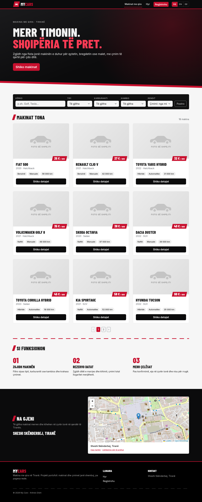
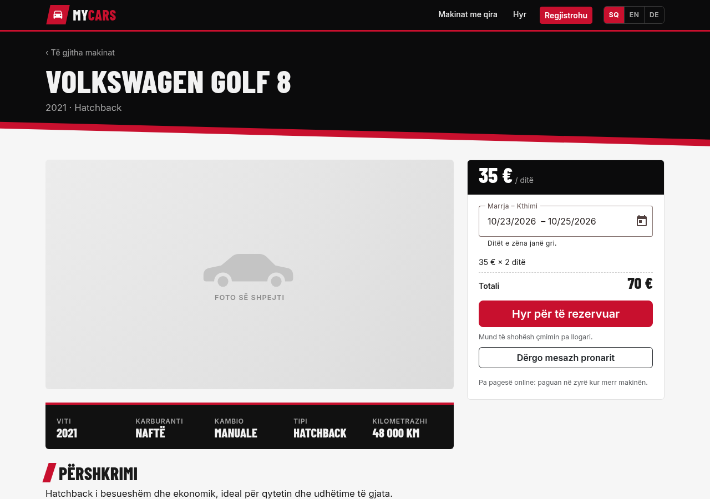
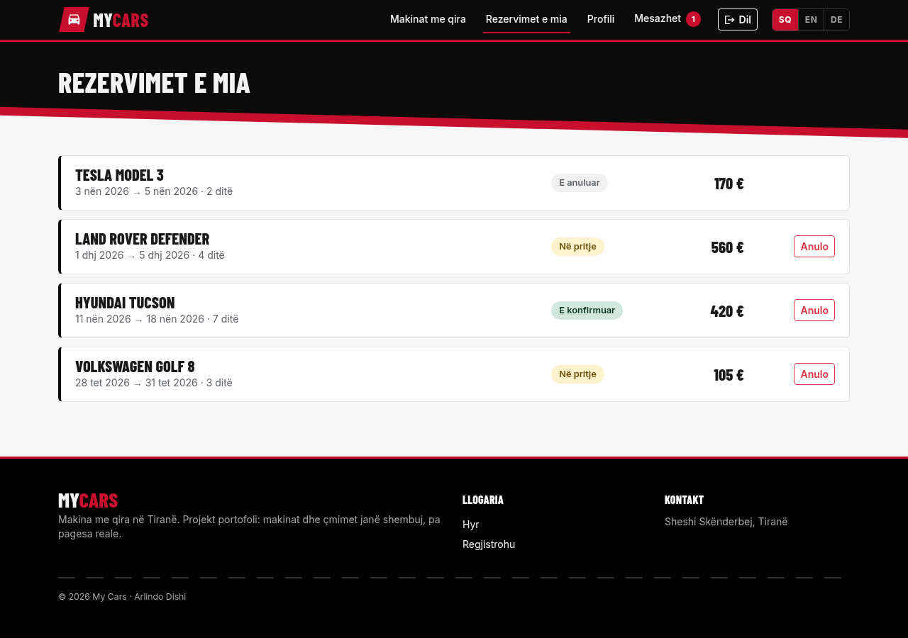
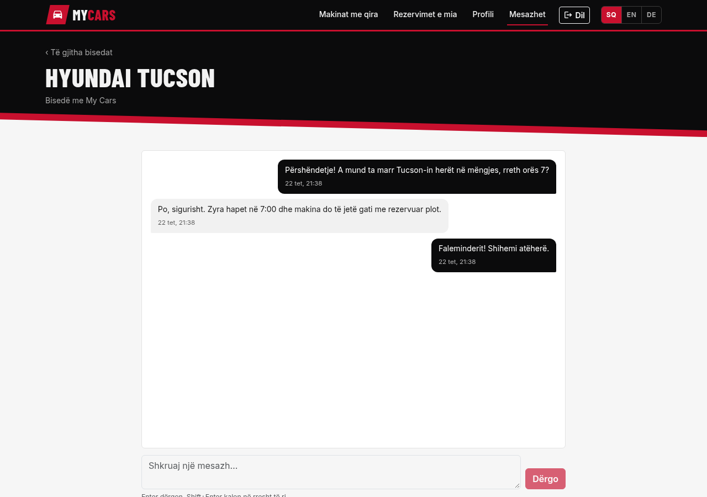
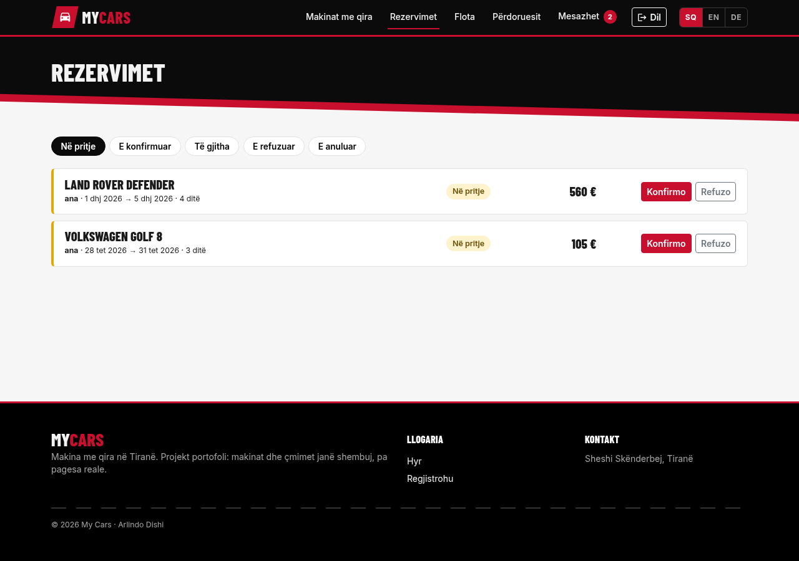
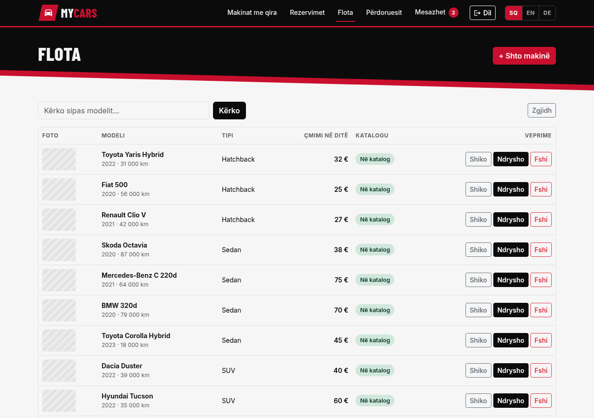
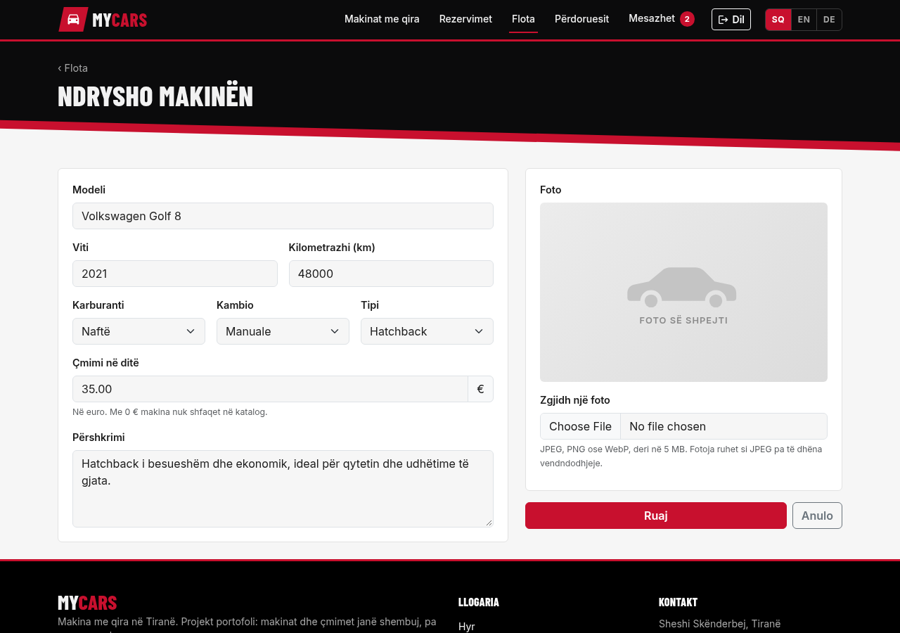
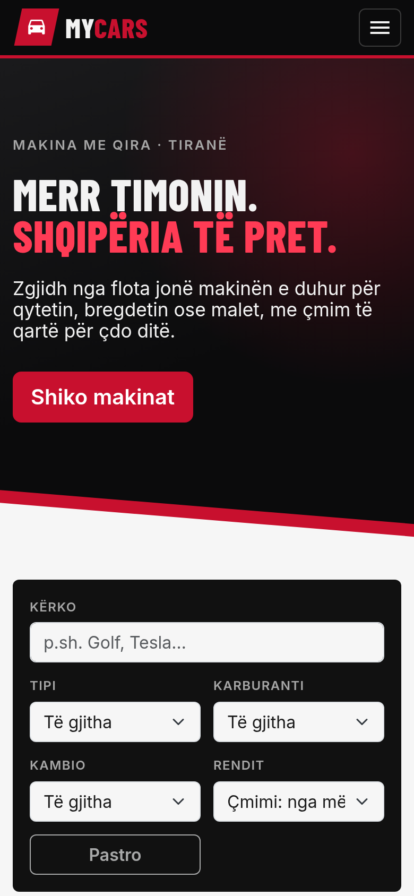
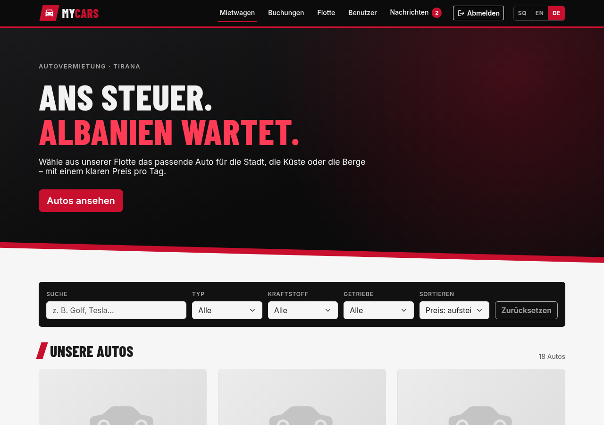

# My Cars: car rental in Tirana

A full-stack car rental website built with **Django REST Framework** and **Angular**. Visitors browse the fleet, filter and compare cars and see the price for their dates. Customers book cars and message the rental. Admins manage the fleet, photos, bookings and users.

It started as a role-based car management app during the ITWorks internship and grew into a portfolio project. The cars, prices and the office address are fictional. There are no real payments.



| Car page with live price | My bookings | Messages |
| --- | --- | --- |
|  |  |  |

| Admin: bookings | Admin: fleet | Admin: car form with photo |
| --- | --- | --- |
|  |  |  |

| Mobile | German |
| --- | --- |
|  |  |

---

## Features

**Public catalog**
- Search by name and filter by type, fuel and gearbox, with sorting and pagination. Filters live in the URL, so links can be shared and the back button keeps them.
- Car page with specs, description, a date-range picker (booked days are greyed out) and a price total calculated by the server.
- The pick-up office is shown on a map (Leaflet + OpenStreetMap).
- Three languages: Albanian (default), English and German. Numbers, dates and the calendar follow the chosen language.

**Customers**
- Book a car for a date range. Bookings start as *pending*, and the customer can cancel them before the start date.
- "Ask the owner": a conversation per car with the rental, updated by polling, with an unread badge in the navigation.
- Profile, password change and self-service account deletion.

**Admins**
- Bookings: confirm or reject pending bookings, filtered by status.
- Fleet: add, edit and delete cars, with price, description and photo upload. A car with a price of 0 € is hidden from the catalog.
- Answer customer messages and manage users and roles.

## Security highlights

- **Server-side rules:** prices are always computed on the server, and roles are checked on every endpoint. Customers only ever see their own bookings and conversations; other ids answer *404*, so objects can't be fetched by guessing ids (no IDOR).
- **No double bookings:**
  - The overlap check runs inside a transaction that locks the car row (`select_for_update`).
  - A threaded test fires two simultaneous requests for the same dates and expects exactly one to succeed. The test fails if the lock is removed.
- **Photo uploads:**
  - Admin only, JPEG/PNG/WebP up to 5 MB, validated with Pillow.
  - Every photo is re-encoded to JPEG under a random file name, which drops EXIF/GPS metadata and anything appended to the file.
  - Served with `nosniff` and `Content-Security-Policy: default-src 'none'`.
- **Messages:**
  - Stored as plain text and rendered through Angular interpolation only. `` shows up as text.
  - Sending is rate-limited to 20 per minute. Polling is never throttled.
- **Production:**
  - `DEBUG` is off unless set, and everything comes from the environment.
  - Cookies are secure, the app is HTTPS-aware behind a proxy, and nginx sends a strict Content Security Policy plus `X-Frame-Options`, `nosniff`, `Referrer-Policy` and `Permissions-Policy`.
  - The containers run as non-root users.

A written security review of the app is planned as a separate case study.

## Tech stack

| | |
| --- | --- |
| Backend | Django 6, Django REST Framework, PostgreSQL, token authentication, Pillow, gunicorn |
| Frontend | Angular 21 (module-based, lazy-loaded feature modules, signals), Angular Material (datepicker, dialogs, snackbars), Bootstrap 5, Leaflet, ngx-translate |
| Deployment | Docker Compose: PostgreSQL 17, gunicorn, nginx (serves the Angular build and proxies the API) |

The project keeps a few architectural constraints from the internship:
- one Django app per domain;
- class-based `APIView`s only;
- hand-written DRF `Serializer`s (no `ModelSerializer`);
- a module-based Angular app with lazy-loaded routing.

## Project structure

```
my_cars/
├── backend/                 Django REST API
│   ├── config/              settings (environment-driven), URLs
│   ├── users/               auth, profiles, user admin, make_admin command
│   ├── cars/                fleet, public catalog API, photo processing, seed_demo command
│   ├── bookings/            bookings, overlap protection, quotes, availability
│   ├── messaging/           customer ↔ rental conversations
│   └── Dockerfile
├── frontend/                Angular app
│   ├── public/i18n/         sq.json, en.json, de.json
│   ├── src/app/
│   │   ├── catalog/         home page, car page, booking card, "ask the owner"
│   │   ├── booking/         my bookings
│   │   ├── messages/        inbox and conversation
│   │   ├── admin/           bookings, fleet, car form, users
│   │   ├── auth/            login, register, profile, guards
│   │   └── shared/          car card, map, price pipe, labels
│   ├── nginx.conf
│   └── Dockerfile
├── docker-compose.yml
└── .env.example             settings for Docker / production
```

## Local development

Requirements: Python 3.12+, Node 22, PostgreSQL.

**Backend**
```bash
cd backend
python3 -m venv venv && source venv/bin/activate
pip install -r requirements.txt
cp .env.example .env          # fill in your database credentials and a secret key
python manage.py migrate
python manage.py seed_demo    # 18 fictional cars (needs an admin user, see below)
python manage.py runserver
```

Create an admin: run `python manage.py createsuperuser`, then `python manage.py make_admin <username>`. `createsuperuser` alone creates a user with the *customer* role.

**Frontend**
```bash
cd frontend
npm install
npx ng serve                  # http://localhost:4200
```

The frontend expects the API at `http://127.0.0.1:8000/api` (`src/environments/environment.ts`). If you serve it on another port, add that origin to `CORS_ALLOWED_ORIGINS` in `backend/.env`.

**Tests**
```bash
cd backend && python manage.py test        # API, permissions, bookings, uploads, messaging
cd frontend && npx ng test --watch=false   # component and service specs (Vitest)
```

## Running with Docker

```bash
cp .env.example .env     # set SECRET_KEY, DB_PASSWORD, ALLOWED_HOSTS, CSRF_TRUSTED_ORIGINS
docker compose up -d --build
docker compose exec backend python manage.py createsuperuser
docker compose exec backend python manage.py make_admin <username>
docker compose exec backend python manage.py seed_demo
```

The site is then at `http://127.0.0.1:8080` (`WEB_BIND` / `WEB_PORT`). The Django admin site lives at `/django-admin/`, because the Angular app uses `/admin`. Migrations and `collectstatic` run automatically when the backend container starts.

For a plain-HTTP test on your own machine, set `SECURE_COOKIES=False`, and include `localhost` in `ALLOWED_HOSTS` and `http://localhost:8080` in `CSRF_TRUSTED_ORIGINS`.

## Deployment

The stack binds to `127.0.0.1:8080` and expects an HTTPS reverse proxy in front of it. With [Caddy](https://caddyserver.com), which gets certificates automatically:

```
arlindo.site {
    reverse_proxy 127.0.0.1:8080
}
```

On the server:
```bash
git clone https://github.com/Arlindo536/my_cars.git && cd my_cars
cp .env.example .env && nano .env      # real secrets, the real domain
docker compose up -d --build
# create the admin and demo data as shown above
```

- **Updating:** `git pull && docker compose up -d --build`.
- **Backup:** `docker compose exec db pg_dump -U my_cars my_cars > backup.sql`.
- **HSTS:** once HTTPS works, set `SECURE_HSTS_SECONDS=31536000` in `.env` and restart the backend.

### Configuration (`.env`)

| Variable | Purpose |
| --- | --- |
| `SECRET_KEY` | Django secret key (required) |
| `DB_NAME`, `DB_USER`, `DB_PASSWORD` | PostgreSQL credentials (password required) |
| `ALLOWED_HOSTS` | Public host names, comma-separated |
| `CSRF_TRUSTED_ORIGINS` | e.g. `https://arlindo.site` (needed by the Django admin) |
| `WEB_BIND`, `WEB_PORT` | Where nginx listens on the host (default `127.0.0.1:8080`) |
| `SECURE_COOKIES` | `True` in production (HTTPS only cookies) |
| `SECURE_HSTS_SECONDS` | HSTS duration; enable after HTTPS works |
